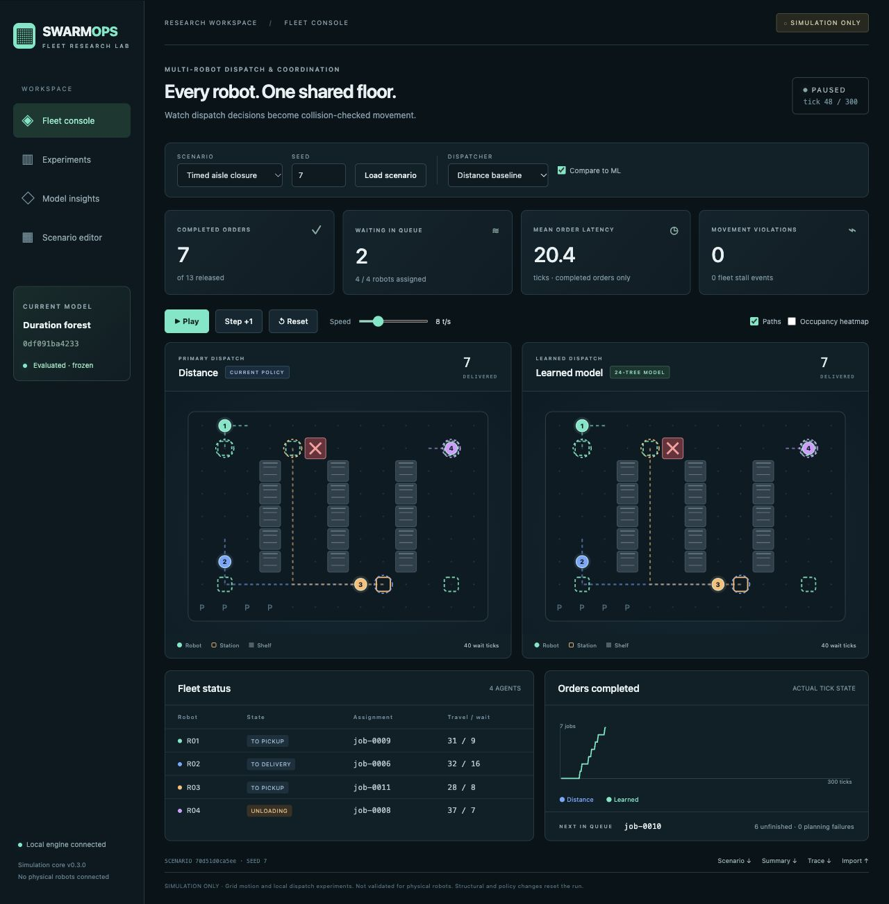
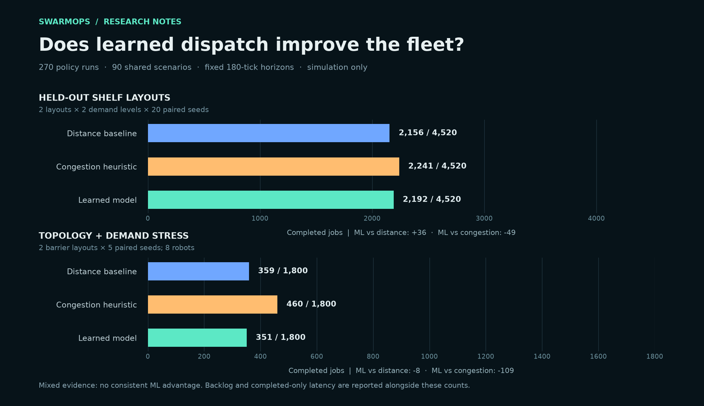
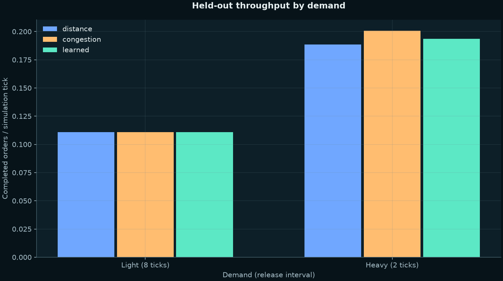
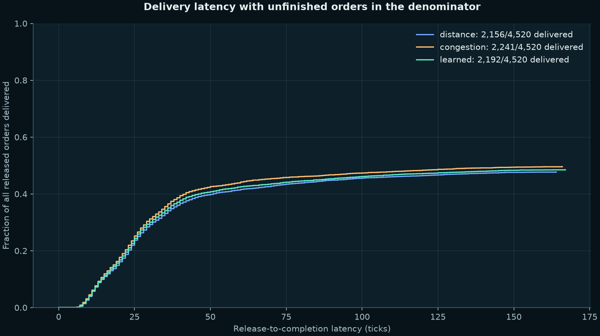
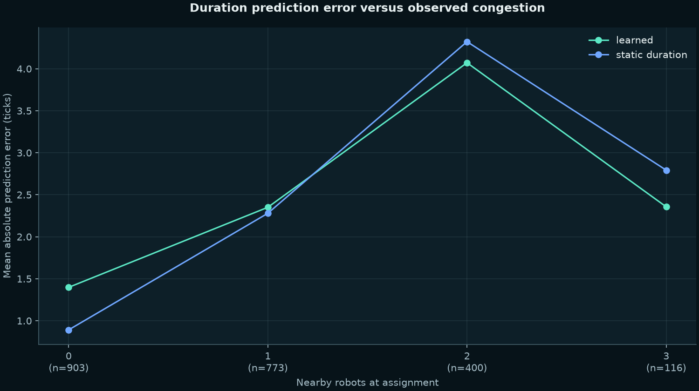
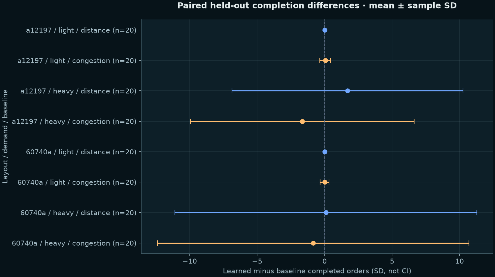
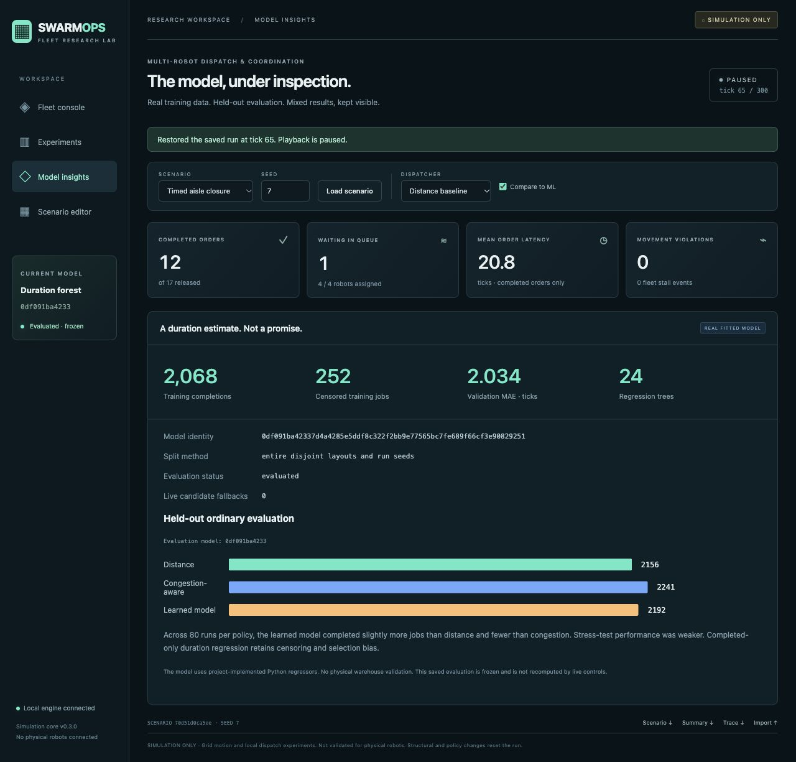
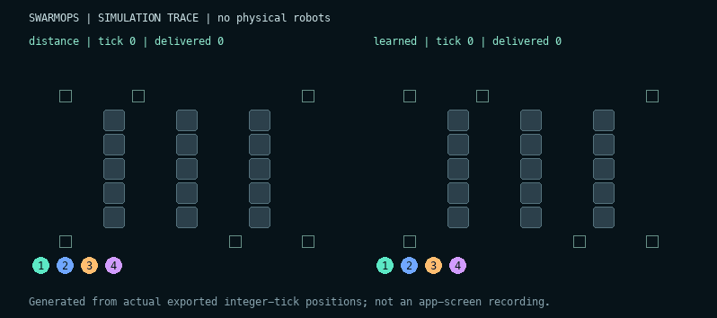
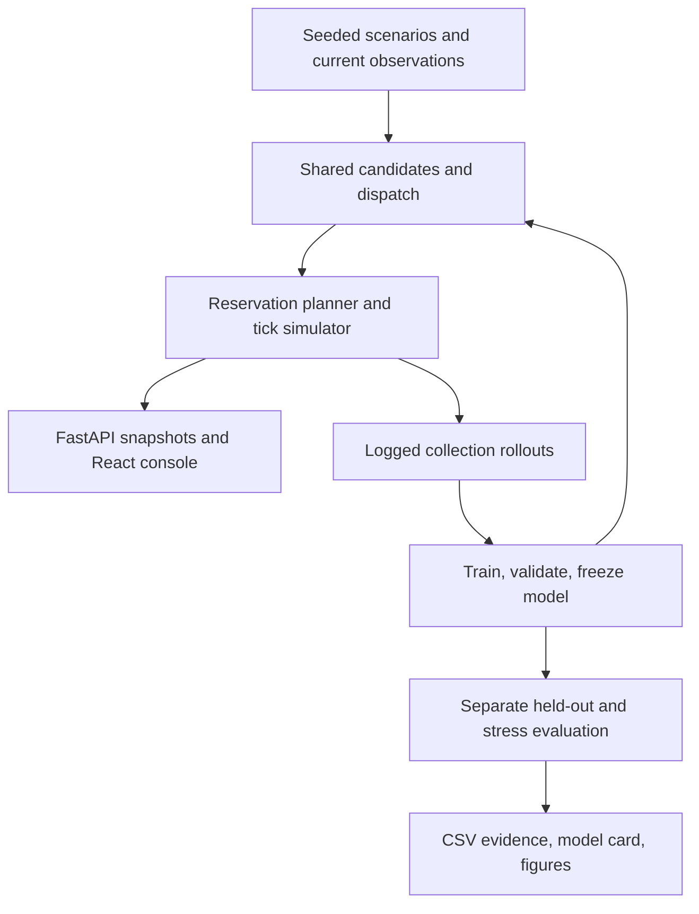

# SwarmOps AI

**A local research console for warehouse robot fleets, learned dispatch, and reproducible experiments.**

[](https://github.com/mirmoosa1014-rgb/swarmops-ai/actions/workflows/ci.yml)
[Model card](docs/model-card.md) · [Measured results](results/ml-full/report.md) · [Research gallery](docs/research-gallery.md) · [MIT license](LICENSE)

Can predicting individual job duration improve an entire robot fleet? SwarmOps tests that question with collision-checked grid simulation, three dispatchers, real supervised models, and a live FastAPI + React console. Everything runs locally. No robots, GPU, paid APIs, accounts, or external datasets are needed.



## The experiment

A trained 24-tree regression forest competes with shortest-distance and congestion-aware dispatch. Every policy receives the same released-job rules, candidate limits, aging, planner, recovery logic, and exogenous scenario inputs. Layouts and run seeds are separated across training, validation, and final tests.

**The result is mixed, not a promised ML win.** On ordinary held-out scenarios, learned dispatch completed slightly more jobs than distance and fewer than congestion. Under topology/load stress, it did worse than both overall.



| Final evaluation | Distance | Congestion | Learned |
|---|---:|---:|---:|
| Ordinary: completed / 4,520 released | 2,156 | 2,241 | 2,192 |
| Ordinary: remaining backlog | 2,364 | 2,279 | 2,328 |
| Stress: completed / 1,800 released | 359 | 460 | 351 |

270 policy runs covered 90 shared scenarios and 48,600 logical ticks, with zero recorded vertex or opposite-edge violations. This is observed simulator evidence, not a guarantee for arbitrary maps or physical robots. Ordinary tests used two held-out layouts, two loads, and 20 paired seeds per layout/load; stress tests used two new barrier layouts, eight robots, and five seeds per layout.

## Research visuals

The figures are generated from saved CSVs. Click for full resolution.

| Throughput by demand | Latency, with unfinished orders retained |
|---|---|
| [](results/ml-full/plots/throughput.png) | [](results/ml-full/plots/latency.png) |

| Duration error versus congestion | Paired differences, mean ± sample SD |
|---|---|
| [](results/ml-full/plots/prediction-error.png) | [](results/ml-full/plots/paired-comparison.png) |

[Waiting-time chart](results/ml-full/plots/waiting.png) · [CSV results](results/ml-full/evaluation-runs.csv) · [Paired differences](results/ml-full/paired.csv) · [MAE and bias](results/ml-full/prediction-metrics.json)

Completed-only error and latency can favor easy jobs; interpret them alongside completion fraction and backlog. SD describes variation, not significance or confidence intervals. Validation importance measures association, not causality.

## Run the console

Requires Python 3.11+ and Node.js 24+. Verification used Python 3.14.3 and Node 24.18.0. Missing dependencies download on first setup; normal use is offline and uses the bundled trained JSON model.

```sh
git clone https://github.com/mirmoosa1014-rgb/swarmops-ai.git
cd swarmops-ai
./launch.sh
```

Open the printed URL, normally **http://127.0.0.1:8765**. If occupied, use `./launch.sh --port 8766`. Ctrl-C stops the launched server; other services are not killed. GitHub hosts the source and visuals, not the running Python backend.

- **Fleet console:** live robots, targets, paths, queues, safety indicators, heatmap, playback, and side-by-side dispatch.
- **Scenario editor:** wall drafts, reachability checks, protected stations, seeded presets, bounded JSON import/export, and safe structural resets.
- **Experiments:** cancellable background comparison with actual results.
- **Model insights:** model hash, sample/censoring counts, validation error, split method, fallbacks, and the frozen measured findings.

Sessions restore deterministically and paused. Exports retain scenario/model identity, logical trace, real events and actual closure timing. See the [console guide](docs/console.md).




The animation renders actual exported tick positions. It is not an app-screen recording or a generated image of alleged results.

## Reproduce and verify

```sh
./test.sh
./run.sh --policy learned --output runs/learned-demo
./compare.sh --quick --output runs/heuristic-comparison
./reproduce.sh --quick --output runs/reproduction-quick
# Fuller collection, fitting, frozen evaluation, reports and PNG charts:
./reproduce.sh --output runs/reproduction-full
```

Use new/empty output directories. Full original numerical reproduction took about 140 seconds on the development machine; runtime varies. Quick mode is a smoke test, not final research evidence. Neither reproduction mode replaces the bundled model. Replacement requires explicit `--install-demo` with the lower-level training command.

42 tests cover paths, reservations, swaps, lifecycle, replay, censoring, data boundaries, splits, fitted models, JSON persistence, fallback, API checks, restore, background work and cancellation. Two API tests skip without web dependencies. Production frontend and relocated clean-copy checks pass. [Browser evidence](results/browser.json) records actual checks and screenshots; a separate download check was interrupted, while export APIs pass.

CI runs backend/model/API tests, a production frontend build, and a bundled learned-policy smoke run with read-only permissions. The badge shows actual hosted status.

## Design and limits



The bounded planner is incomplete; some corridors remain blocked despite existing coordinated solutions. Unfinished work stays visible. Grid motion has no acceleration, turning radius, battery, sensing, or physical dynamics. Completed-only regression has selection/censoring bias; duration accuracy does not directly optimize fleet throughput.

Models are project-implemented ridge/forest regressors, **not scikit-learn**. Scientific packages were unavailable during training, so the numerical pipeline uses standard Python. Later dependency access enabled FastAPI and Matplotlib without changing the frozen model. Persistence uses bounded numerical JSON, never uploaded pickle/joblib. The server binds loopback and is not configured for public internet exposure.

[Architecture](docs/architecture.md) · [Planner](docs/planner.md) · [Dispatch](docs/dispatch.md) · [Learning](docs/learning.md) · [Reviewer guide and demo](docs/reviewer-guide.md) · [Attribution](THIRD_PARTY.md)

Created with project direction and feedback from Moosa Mir, and development assistance from Codex. Results describe a software simulation and do not claim physical robot deployment or real warehouse savings.
