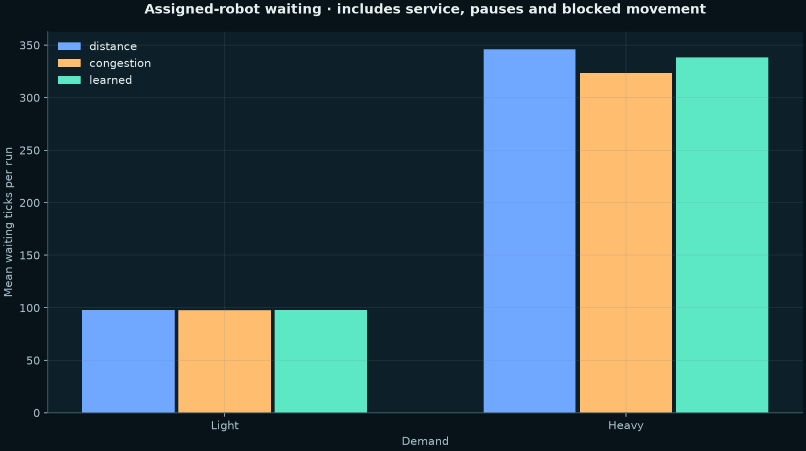
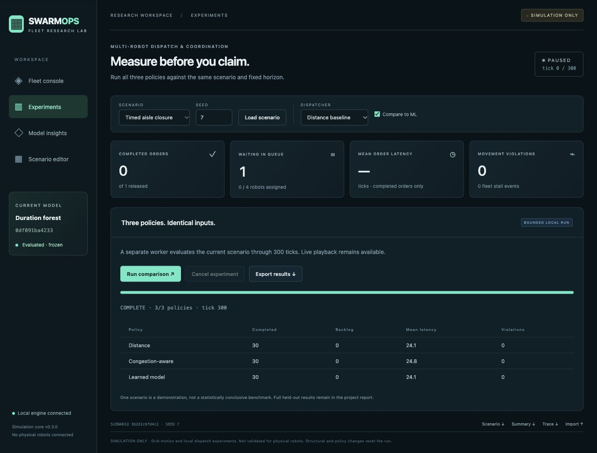

# Research gallery

All graphs come from committed evaluation CSVs. Rendering does not refit the model.
Sources: scripts/render-scientific-plots.py and scripts/render-research-overview.py.

The latency denominator includes all released orders, so curves do not reach
100% when jobs remain unfinished at the horizon.

Errors use completed learned-policy assignments. Bucket counts are shown;
difficult censored jobs may be absent from this observed sample.

Zero means equal completed counts. Bars are sample SD across paired seeds,
not confidence intervals or proof of statistical significance.

Waiting includes service, pauses and blocked movement while assigned, and
excludes idle parking time.

The GIF renders exported positions rather than recording the browser. No stock
or generated warehouse imagery is used as evidence of a working system.
